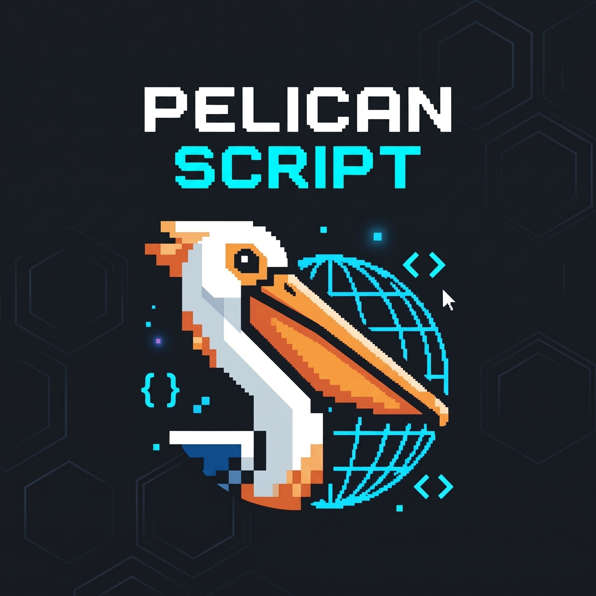

<div align="center">
  
  <h1>PELICAN SCRIPT</h1>
  <p><strong>Sub-Second Digital Assets & Custom Web Engineering for Caribbean Businesses</strong></p>

  <p>
    <a href="https://pelican-script.vercel.app">
      
    </a>
    
    
  </p>

  <p>
    <a href="#-overview">Overview</a> •
    <a href="#-key-features">Key Features</a> •
    <a href="#-project-architecture">Architecture</a> •
    <a href="#-local-development">Local Setup</a> •
    <a href="#-roadmap">Roadmap</a>
  </p>
</div>

---

## ⚡ Overview

**Pelican Script** is the flagship agency website for a Kingston-based web engineering studio founded by **Lincoln Green**. Built from the ground up with zero framework bloat, the platform delivers instant load times, 100% asset ownership for clients, and a distinctive dark-mode cyber-terminal aesthetic.

> *Engineered to prove that small and medium-sized Caribbean enterprises don't need slow, bloated SaaS page builders to stand out online.*

---

## ✨ Key Features

* **🎨 Cyber-Terminal HUD Aesthetic:** High-visibility 45° PCB circuit trace background (`#080d14`), neon cyan accents (`#00f3ff`), and crisp `JetBrains Mono` / `Silkscreen` typography.
* **🃏 Device-Aware 3D Pricing Matrix:** Interactive 3D perspective flip-cards (`rotateY(180deg)`) featuring isolated `@media (hover: hover)` desktop rules and an accordion-style tap-to-flip + dismiss-on-tap-away UX tailored specifically for iOS Mobile Safari.
* **📩 Serverless Lead Intake Pipeline:** Integrated with **Web3Forms** with honeypot spam protection, custom email subjects, and an automated redirect to a branded confirmation screen (`thanks.html`).
* **🧩 Modular Component Architecture:** Shared navigation headers, footers, and interactive metrics managed cleanly through vanilla JavaScript (`components.js`, `main.js`, `metrics.js`).
* **🔍 Technical SEO Ready:** Pre-configured with Open Graph metadata, JSON-LD structured schema, `robots.txt`, and `sitemap.xml` ready for custom domain indexing.

---

## 📂 Project Architecture

```text
pelican-script/
├── buttons/             # Custom call-to-action assets (WhatsApp & interactive badges)
├── css/
│   ├── main.css         # Core design tokens, resets, and base layout rules
│   └── styles.css       # Cyber PCB background, 3D card transforms, and responsive media queries
├── docs/                # Agency documentation, billing policies, and internal specs
├── icons/               # Favicons and UI vector icons
├── img/                 # Brand logos, project showcase previews, and graphics
├── scripts/
│   ├── components.js    # Reusable header/footer injection & active nav state
│   ├── main.js          # Mobile drawer toggle & iOS-safe 3D flip-card accordion logic
│   └── metrics.js       # Dynamic performance counters and telemetry animations
├── index.html           # Landing page, value proposition, and featured pricing overview
├── gallery.html         # Client work showcase and performance case studies
├── pricing.html         # Full tier breakdown, feature comparison, and interactive FAQ
├── about.html           # Studio mission, engineering philosophy, and founder profile
├── contact.html         # Project inquiry form powered by Web3Forms
├── thanks.html          # Post-submission confirmation screen
├── robots.txt           # Search engine crawler directives
├── sitemap.xml          # XML route directory for Google Search Console
└── README.md            # Project documentation
```

---

## 🛠️ Tech Stack

| Layer | Technology | Purpose |
| :--- | :--- | :--- |
| **Markup** | Semantic HTML5 | Accessible, SEO-structured multi-page architecture |
| **Styling** | Modern CSS3 | CSS Grid, Flexbox, 3D transforms, pointer media queries, backdrop filters |
| **Interactivity** | Vanilla ES6+ JavaScript | Zero-dependency DOM manipulation, mobile nav, and touch-safe card states |
| **Form Routing** | Web3Forms API | Serverless form submissions with anti-bot filtering |
| **Deployment** | Vercel & GitHub | Continuous deployment pipeline with automatic HTTPS |

---

## 🚀 Local Development

Because Pelican Script uses zero build tools or bundlers, running it locally takes seconds:

1. **Clone the repository:**
   ```bash
   git clone https://github.com/your-username/pelican-script.git
   cd pelican-script
   ```
2. **Start a local development server:**
   * **VS Code:** Right-click `index.html` and select **Open with Live Server**.
   * **Python:** Run `python -m http.server 8000` and visit `http://localhost:8000`.

---

## 🗺️ Roadmap

- [x] Core responsive multi-page architecture (`index`, `gallery`, `pricing`, `about`, `contact`)
- [x] Web3Forms inquiry pipeline & custom `thanks.html` redirect
- [x] iOS Mobile Safari 3D card flip accordion & tap-away dismissal
- [x] Root SEO files (`robots.txt` & `sitemap.xml`)
- [ ] Map custom domain (`pelicanscript.com`) via Vercel DNS & update Web3Forms redirect URL
- [ ] Submit `sitemap.xml` to Google Search Console
- [ ] **v1.1 Polish:** Refine typography hierarchy, add JMD/USD currency toggle, and ship custom `404.html`

---

<div align="center">
  <sub>Built in Kingston, Jamaica 🇯🇲 by <strong>Lincoln Green</strong> • Powered by Pelican Script</sub>
</div>